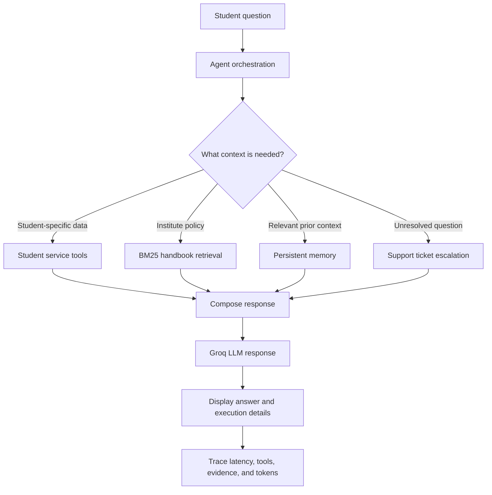

# CampusAI — Intelligent Student Support Agent

A demonstration AI-powered student support application built with **Python, Streamlit, and Groq**. CampusAI helps students ask questions about fees, academic records, scholarships, institute policies, and support requests. The agent can select relevant tools, retrieve policy information from a student handbook, and use persistent memory when appropriate.

> **Project note:** This is an academic prototype that uses local demonstration data. The student selector is not authentication, and the fee-waiver approval workflow is not protected by real reviewer authentication. Do not use it to make real student-service or financial decisions.

## Features

### AI student assistant

- Chat-style interface built with Streamlit.
- Answers questions about fee status, academic records, scholarships, institute policies, and student support.
- Uses the Groq model integration configured by the project.
- Provides quick-action prompts for common student questions.
- Supports a new-conversation action and maintains conversation history during the current Streamlit session.

### Agent tools

The agent can select tools for requests that require student-specific information or administrative follow-up. The assignment implementation includes:

- `check_fee_status` — retrieves fee information, amounts paid, outstanding balances, and payment deadlines.
- `check_student_record` — retrieves available academic and programme information for a student.
- `check_scholarship_status` — checks scholarship information and eligibility or renewal criteria present in the sample data.
- `create_support_ticket` — escalates questions that cannot be resolved from the available tools or policy information.

### Policy retrieval (RAG)

- Uses `data/student_handbook.md` as the policy source.
- Splits handbook content into searchable sections/chunks.
- Uses BM25 retrieval to select relevant policy content for a question rather than sending the complete handbook each time.

### Persistent memory and context selection

- Stores useful student context between sessions using the local memory store.
- Selects relevant context for the current request.
- Includes safeguards intended to reject sensitive or temporary information such as passwords and OTPs from memory.
- The interface can display a memory notice when the agent reports one.

### Student workspace

- Select a demonstration student profile from the sidebar.
- View the selected student's name, ID, programme, and available academic fields.
- View conversation count and active student information.
- Use quick prompts to start common requests.

### Human-in-the-loop fee-waiver demonstration

- Submit a fee-waiver request with an amount and reason.
- View pending requests.
- Demonstrate approve/reject decisions for pending requests.

This approval workflow is for demonstration only. The selected student identity is not an authenticated reviewer account.

### Agent transparency and evaluation

For assistant responses, the interface can show available execution details, including:

- Tools used.
- Retrieved policy evidence.
- Memory notice, when available.
- Response latency.
- Total token usage.

The evaluation script runs the project's demonstration scenarios and reports agent behaviour and performance information.

## Technology stack

- **Python 3.11** (Python 3.10 or 3.11 is supported by the original project setup instructions)
- **Streamlit** — web interface
- **Groq** — LLM inference
- **BM25 retrieval** — handbook/policy search
- **JSON files** — demonstration student data, tickets, and memory
- **Python modules** — agent orchestration, tools, memory, tracing, and approvals

## Project structure

```text
Agentic-AI-Assignment-BDA-/
│
├── app.py                       # Streamlit CampusAI web application
├── main.py                      # Terminal-based student support agent
├── evaluate.py                  # Runs the demonstration evaluation scenarios
├── requirements.txt             # Python dependencies
├── .env.example                 # Example environment configuration
├── .gitignore                   # Excludes secrets and local/generated files
├── README.md                    # Project documentation
├── EVALUATION_REPORT.md         # Evaluation summary
│
├── data/
│   ├── student_handbook.md      # Institute policy source for RAG
│   ├── students_db.json         # Demonstration student records
│   ├── tickets_db.json          # Demonstration support-ticket data
│   └── memory_store.json        # Persistent student memory store
│
├── logs/                        # Application/evaluation logs, when generated
│
└── src/
    ├── __init__.py
    ├── config.py                # Configuration and API-key handling
    ├── groq_client.py           # Groq client wrapper
    ├── tools.py                 # Student-service tool implementations
    ├── policy_retriever.py      # Handbook chunking and BM25 retrieval
    ├── memory.py                # Persistent memory and information filters
    ├── agent.py                 # Agent loop and context selection
    ├── tracer.py                # Execution tracing and evaluation support
    └── approvals.py             # Fee-waiver request and decision workflow
```

The JSON files and log files may be created or updated as the application runs. Keep the sample data structure consistent with the code if you edit or add records.

## Requirements

- Windows, macOS, or Linux.
- Python **3.10 or 3.11**. Python 3.11 is recommended for this setup.
- Git (optional, for cloning the repository).
- A Groq API key: [Groq Console — API Keys](https://console.groq.com/keys).

## Setup on Windows using VS Code

### 1. Clone the repository

Open the integrated terminal in VS Code using **Terminal → New Terminal**, then run:

```powershell
git clone https://github.com/Apurv-Chauhan/Agentic-AI-Assignment-BDA-.git
cd Agentic-AI-Assignment-BDA-
code .
```

If the project is already open in VS Code, skip the clone commands and make sure the terminal is in the project root (the folder containing `app.py` and `requirements.txt`).

### 2. Create a virtual environment

```powershell
py -3.11 -m venv .venv
```

Activate it:

```powershell
.\.venv\Scripts\Activate.ps1
```

If PowerShell blocks activation for the current terminal session, run:

```powershell
Set-ExecutionPolicy -Scope Process -ExecutionPolicy Bypass
.\.venv\Scripts\Activate.ps1
```

When activation succeeds, `(.venv)` should appear at the beginning of the terminal prompt.

### 3. Select the interpreter in VS Code

1. Press `Ctrl + Shift + P`.
2. Select **Python: Select Interpreter**.
3. Choose the interpreter at `.venv\Scripts\python.exe` inside the project folder.

### 4. Install dependencies

```powershell
python -m pip install --upgrade pip
pip install -r requirements.txt
```

### 5. Configure the Groq API key

1. Open `.env.example` in the project root.
2. Create a copy named `.env` in the same folder.
3. Add your Groq API key to `.env`, using the exact variable name shown in `.env.example`.
4. Save the file.

Example format (use the variable name from your own `.env.example`):

```env
GROQ_API_KEY=your_groq_api_key_here
```

The Streamlit application calls the API-key setup in non-interactive mode, so configure `.env` before launching the web app. The terminal application may prompt for a key if it is not already configured, depending on the project's configuration code.

**Important:** Never commit or share `.env`. Do not paste API keys into screenshots, chat messages, source files, or GitHub. The repository's `.gitignore` should exclude `.env` and `.venv`.

## Run the application

### Streamlit web application — recommended

From the project root, with `.venv` activated and `.env` configured, run:

```powershell
streamlit run app.py
```

Streamlit normally opens the application in your browser at:

```text
http://localhost:8501
```

The web interface contains three main tabs:

1. **AI Assistant** — chat with the agent and inspect tools, evidence, memory notices, latency, and token usage.
2. **Student profile** — view fields available for the selected demonstration student in `data/students_db.json`.
3. **Human approvals** — submit a fee-waiver request and review pending demonstration requests.

The sidebar lets you choose a demonstration student, use quick actions, or start a new conversation.

### Terminal chat application

To use the command-line interface instead:

```powershell
python main.py
```

### Run evaluation scenarios

```powershell
python evaluate.py
```

Review the evaluation output and the project's `EVALUATION_REPORT.md`. Actual latency and token counts can vary between runs and depend on the model/API response.

## Example questions to test

Try these questions in the AI Assistant tab or terminal chat:

```text
What is my current fee status?
Check my academic profile.
What scholarship am I eligible for?
What is the policy if the payment portal fails?
What electives would you recommend based on my academic interests?
I have a question that is not covered in the handbook. Can you raise a support ticket?
```

Use only the synthetic/demo student records included with the project. Do not enter real passwords, OTPs, payment credentials, or other confidential information.

## Agent workflow



The agent should use only the information required for the current question. If the available records or handbook do not answer a question, the agent can use the support-ticket path rather than inventing an institutional policy.

## Data and privacy notes

- `data/students_db.json` contains demonstration student records. Do not replace it with real student data unless you have the necessary authorization and security controls.
- `data/student_handbook.md` is the local policy source used for retrieval. Update it only with approved, accurate policy content.
- `data/memory_store.json` is the persistent memory store. Inspect it when testing what the agent remembers.
- `data/tickets_db.json` stores demonstration support-ticket records.
- `.env` contains your local API key and must remain private.
- The student selector is a demo identity selector, not a login system.
- The fee-waiver approval controls do not provide authenticated reviewer permissions, audit-grade controls, or production financial safeguards.

## Troubleshooting

| Problem | What to check |
|---|---|
| `py -3.11` is not found | Install Python 3.11, then reopen the VS Code terminal and run `py -0p`. |
| Virtual environment activation is blocked | Run the process-scoped PowerShell execution-policy command shown above, then activate again. |
| `ModuleNotFoundError` | Confirm `(.venv)` is active, select `.venv` in VS Code, and run `pip install -r requirements.txt`. |
| Groq/API-key error | Check that `.env` exists in the project root, the variable name matches `.env.example`, and the key is valid. Never post the key in an issue or screenshot. |
| No student records found | Check that `data/students_db.json` exists and contains valid JSON records. |
| Streamlit command is not found | Activate `.venv` and reinstall dependencies with `pip install -r requirements.txt`. |
| Port 8501 is already in use | Start Streamlit on another port, for example `streamlit run app.py --server.port 8502`. |

## Submission checklist

- [ ] `app.py` launches the Streamlit interface.
- [ ] `main.py` launches the terminal agent.
- [ ] `evaluate.py` runs the demonstration evaluation scenarios.
- [ ] Student records and handbook files are present in `data/`.
- [ ] Groq API key is configured locally in `.env`.
- [ ] `.env` and `.venv/` are not committed to GitHub.
- [ ] Agent tool usage, policy retrieval, memory behaviour, and escalation have been tested.
- [ ] Screenshots of the working interface and evaluation output are ready for the assignment demonstration.

## Author / course

**Course:** Agentic AI Engineering  
**Programme:** PGDM — Big Data Analytics / AI & Data Science  
**Batch:** 2025–27
